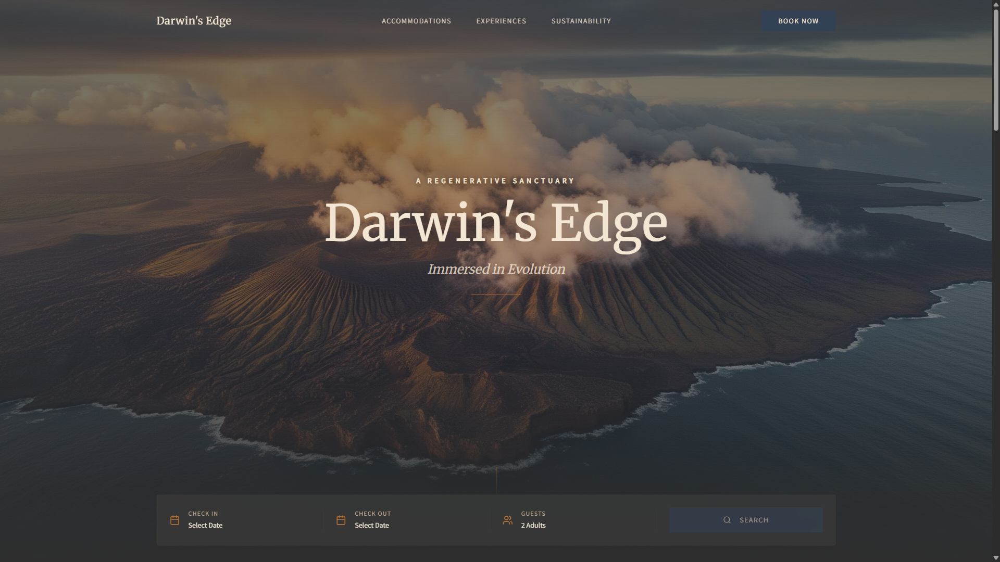

# Darwin's Edge

[](https://darwinsedge.netlify.app/)

A luxury eco-lodge hospitality and sustainable tourism web platform set in the Galápagos Islands. Built with React 18, Vite, TypeScript, Tailwind CSS, Framer Motion, and Firebase Firestore.



<div align="center">
  
  
  
  
  
  
  
</div>

---

## Features

### 🌋 Immersive Galápagos Experience
- Cinematic volcanic and archipelago visual design powered by Framer Motion entrance animations.
- Sustainable hospitality storytelling centered on conservation and low-impact tourism.

### 🛎️ Real-Time Reservation & Availability Engine
- Interactive booking bar with date-range pickers and dynamic guest selection.
- Room tier showcase: Oceanfront Villas, Volcanic Suites, and Canopy Treehouses.

### 📊 Administrative Management Dashboard
- Integrated booking calendar and reservation tracking.
- Protected authentication routes backed by Firebase.

---

## Project Structure

```
DARWIN'S EDGE/
├── src/
│   ├── components/      # UI components (Hero, BookingBar, AccommodationsSlider, Header)
│   ├── pages/           # Application views (Index, Booking, Dashboard, Login)
│   ├── lib/             # Utility helpers and Firestore configuration
│   └── assets/          # High-resolution Galápagos imagery and visual assets
├── public/              # Static assets and favicon
│   └── preview.png      # Application hero screenshot preview
├── server/              # Backend payment / notification microservice
└── index.html           # Application root entrypoint
```

---

## Getting Started

### Prerequisites
- Node.js 18+
- npm or bun

### Installation
```bash
# Clone the repository
git clone https://github.com/adriangbustos/Darwins-Edge.git
cd Darwins-Edge

# Install dependencies
npm install

# Start development server
npm run dev
```
Open `http://localhost:5173` in your web browser.

---

## License

This project is licensed under the MIT License - see the [LICENSE](LICENSE) file for details.
